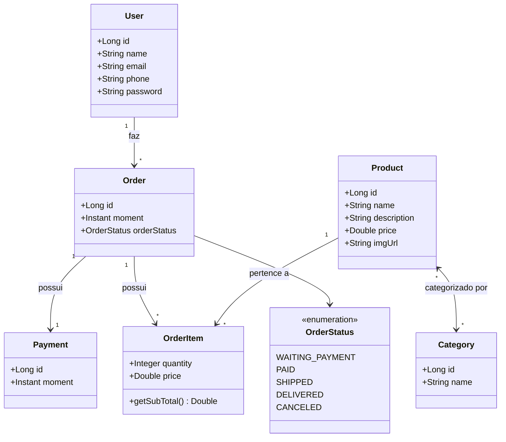

# 🛒 E-Commerce API

> API RESTful desenvolvida com **Java** e **Spring Boot** para gerenciamento completo de um domínio de E-Commerce, incluindo controle de usuários, produtos, categorias, pedidos e pagamentos.

---

## 📌 Sobre o Projeto

A **E-Commerce API** é uma aplicação backend construída seguindo as melhores práticas de arquitetura em camadas (Controladores, Serviços, Repositórios e Entidades de Domínio). A aplicação inclui:

- **Modelo de Domínio Completo**: Relacionamentos complexos (1:1, 1:N, N:N) e entidade de associação com chave composta (`OrderItem`).
- **Tratamento Global de Exceções**: Manipulação customizada de erros REST (`ResourceNotFoundException`, `DatabaseException`) com respostas JSON padronizadas.
- **Banco de Dados em Memória & Produção**: Configuração pronta para **H2 Database** em perfil de testes e suporte a **PostgreSQL**.
- **Carga de Dados Automática (Seeding)**: Instanciação inicial de objetos para testes através da classe `TestConfig`.

---

## 📐 Modelo de Domínio (Diagrama de Classes)



---

## 🚀 Tecnologias Utilizadas

- **Linguagem**: Java 25
- **Framework**: Spring Boot
  - Spring Data JPA (Persistência de Dados / Hibernate)
  - Spring Web (MVC / REST API)
  - Spring Boot H2 Console
- **Bancos de Dados**:
  - H2 Database (Banco em memória para ambiente de testes)
  - PostgreSQL (Suporte para produção)
- **Gerenciador de Dependências**: Apache Maven

---

## 🏗️ Arquitetura do Sistema

A aplicação adota a arquitetura clássica em camadas:

```text
               ┌───────────────────────────────┐
               │    Controladores (Resources)   │
               └──────────────┬────────────────┘
                              │
                              ▼
               ┌───────────────────────────────┐
               │           Serviços            │
               └──────────────┬────────────────┘
                              │
                              ▼
               ┌───────────────────────────────┐
               │          Repositórios         │
               └──────────────┬────────────────┘
                              │
                              ▼
               ┌───────────────────────────────┐
               │   Modelo de Domínio / Banco   │
               └───────────────────────────────┘
```

---

## 🔌 Endpoints da API

### 👤 Usuários (`/users`)
| Método | Endpoint | Descrição |
|---|---|---|
| `GET` | `/users` | Lista todos os usuários |
| `GET` | `/users/{id}` | Busca usuário por ID |
| `POST` | `/users` | Cria um novo usuário |
| `PUT` | `/users/{id}` | Atualiza dados do usuário |
| `DELETE` | `/users/{id}` | Remove um usuário |

#### Exemplo de Corpo de Requisição (`POST /users`):
```json
{
  "name": "Maria Brown",
  "email": "maria@gmail.com",
  "phone": "988888888",
  "password": "123456"
}
```

---

### 📦 Produtos (`/products`)
| Método | Endpoint | Descrição |
|---|---|---|
| `GET` | `/products` | Lista todos os produtos |
| `GET` | `/products/{id}` | Busca produto por ID |

---

### 🏷️ Categorias (`/categories`)
| Método | Endpoint | Descrição |
|---|---|---|
| `GET` | `/categories` | Lista todas as categorias |
| `GET` | `/categories/{id}` | Busca categoria por ID |

---

### 📑 Pedidos (`/orders`)
| Método | Endpoint | Descrição |
|---|---|---|
| `GET` | `/orders` | Lista todos os pedidos |
| `GET` | `/orders/{id}` | Busca pedido por ID (com itens e pagamento) |

---

## ⚠️ Tratamento de Erros

A API retorna erros estruturados seguindo o padrão HTTP:

### Exemplo de Erro `404 Not Found` (Recurso Não Encontrado)
```json
{
  "timestamp": "2026-10-07T12:00:00Z",
  "status": 404,
  "error": "Resource not found",
  "message": "Resource not found. Id 99",
  "path": "/users/99"
}
```

### Exemplo de Erro `400 Bad Request` (Violação de Integridade do Banco)
```json
{
  "timestamp": "2026-10-07T12:00:00Z",
  "status": 400,
  "error": "Database error",
  "message": "Integrity constraint violation",
  "path": "/users/1"
}
```

---

## 🛠️ Como Executar o Projeto

### Pré-requisitos
- **Java JDK 21+** (recomendado Java 25)
- **Git**
- **Maven** (opcional, o projeto possui `mvnw`)

### Passo a Passo

1. **Clonar o Repositório:**
   ```bash
   git clone https://github.com/seu-usuario/ecommerce-api.git
   cd ecommerce-api
   ```

2. **Executar a Aplicação:**
   - **Linux/macOS:**
     ```bash
     ./mvnw spring-boot:run
     ```
   - **Windows:**
     ```cmd
     mvnw.cmd spring-boot:run
     ```

3. **Acessar o Banco H2 Console (Ambiente de Teste):**
   - **URL**: `http://localhost:8080/h2-console`
   - **JDBC URL**: `jdbc:h2:mem:testdb`
   - **User Name**: `sa`
   - **Password**: *(em branco)*

4. **Testar os Endpoints:**
   Acesse no navegador ou cliente HTTP (Postman/Insomnia):
   - `http://localhost:8080/users`
   - `http://localhost:8080/products`
   - `http://localhost:8080/categories`
   - `http://localhost:8080/orders`

---

## 📜 Licença

Este projeto foi desenvolvido para fins de estudos e aprimoramento em desenvolvimento Java backend com Spring Boot.